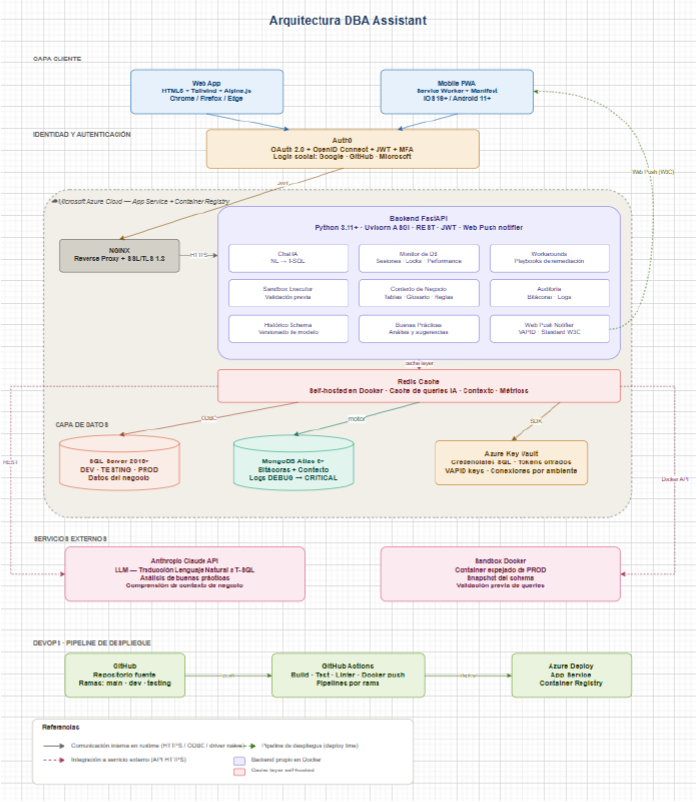

# Arquitectura

**Regla principal:** toda decisión técnica se mantiene lo más fiel posible a este
diagrama. Cualquier desvío se documenta acá con su motivo.

## Correspondencia diagrama → código

| Bloque del diagrama | Implementación |
|---|---|
| Web App (HTML5 + Tailwind + Alpine.js) | `backend/app/web/` — plantillas Jinja2 renderizadas por FastAPI, Alpine.js para la interactividad, Tailwind compilado (`backend/tailwind/`) |
| Mobile PWA (Service Worker + Manifest) | Mismo front adaptado: `static/manifest.webmanifest`, `static/sw.js` |
| Auth0 | Pendiente de configuración (ver `docs/auth0.md`) |
| NGINX (Reverse Proxy + SSL/TLS 1.3) | `nginx/` — TLS 1.3, estáticos y proxy al backend |
| Backend FastAPI (Python + Uvicorn ASGI) | `backend/app/` — un único servicio organizado en módulos |
| Módulos del backend | `backend/app/modulos/<modulo>/` (ver tabla siguiente) |
| Redis Cache (self-hosted en Docker) | `backend/app/datos/cache.py`, servicio `redis` |
| SQL Server 2019+ (ODBC) | `backend/app/datos/sqlserver.py` (pyodbc + ODBC Driver 18), servicio `sqlserver` |
| MongoDB 6+ (motor) | `backend/app/datos/mongo.py`, servicio `mongo` |
| Azure Key Vault | `backend/app/core/secretos.py` — hoy lee `.env`; al migrar se agrega el proveedor de Key Vault |
| Anthropic Claude API | Módulo `chat_ia` (modelo configurable, por defecto Claude Haiku 5.5) |
| Sandbox Docker | Módulo `sandbox` |
| GitHub Actions | `.github/workflows/ci.yml` |
| Azure Deploy | Diferido hasta que el sistema esté funcional |

### Módulos del backend

| Diagrama | Paquete |
|---|---|
| Chat IA (NL → T-SQL) | `chat_ia` |
| Monitor de BD (sesiones, locks, performance) | `monitor` |
| Workarounds (playbooks de remediación) | `workarounds` |
| Sandbox Executor (validación previa) | `sandbox` |
| Contexto de Negocio (tablas, glosario, reglas) | `contexto_negocio` |
| Auditoría (bitácoras, logs) | `auditoria` |
| Histórico Schema (versionado del modelo) | `historico_schema` |
| Buenas Prácticas (análisis y sugerencias) | `buenas_practicas` |
| Web Push Notifier (VAPID, estándar W3C) | `web_push` |
| Alertas *(agregado)* | `alertas` |

## Decisiones tomadas

| Tema | Decisión |
|---|---|
| Front | Lo sirve el backend (Jinja2). NGINX entrega los estáticos. |
| Tailwind | Compilado con el ejecutable oficial (sin Node). El CDN no es apto para producción. |
| Backend | Un único servicio (monolito modular). |
| Python | 3.14, la última versión estable. |
| Dependencias | `uv` con `pyproject.toml` y `uv.lock`. |
| Linter / tests | `ruff` (lint y formato) y `pytest` con cobertura mínima del 80%. |
| SQL Server | Estructura funcional: tenants, conexiones, usuarios, roles, permisos por ambiente, métricas y umbrales, reglas de alerta, alertas, workarounds y versiones. Imagen 2022 en Docker, accesible desde SSMS en `localhost,14330`. |
| MongoDB | Bitácoras (transacciones, auditoría, excepciones, sandbox), contexto de negocio, informes de buenas prácticas, snapshots de schema y dispositivos push. |
| Redis | Contenedor propio. TTL configurables solo por variable de entorno. |
| Secretos | `.env` en local, detrás de una interfaz; Key Vault por ambiente al migrar a Azure. |
| IA | Claude Haiku 5.5 por defecto. |
| MFA | Obligatorio al ingresar; segundo factor nuevamente al ejecutar acciones sobre conexiones PROD. |
| Login | Google y email + contraseña, siempre con MFA. |
| Roles | Tres: Administrador, DBA y Consulta (no los cinco del diseño). Módulos por rol en la tabla siguiente. |
| Instancias monitoreadas | Solo SQL Server sobre Windows. Las registra el usuario. |
| Sandbox (detalle) | Un contenedor persistente por cada IP registrada, con todas sus bases. Solo estructura. Se sincroniza a diario y se verifica alineación antes de cada validación. |
| Ejecución | Dry-run en sandbox y confirmación del usuario antes de ejecutar en la base real. |
| Alertas | Motor caído, base caída, bloqueos y poco espacio (disco, datos y log). Réplica, más adelante. Notificación por la PWA; email más adelante. |
| Ambientes | Uno solo por ahora. Ramas `main` y `dev`. |
| Idioma | Español; textos en `app/web/i18n/` para agregar inglés después. |
| Multi-tenant | Desde el inicio. Base central `<prefijo>_Catalogo` con la lista de tenants; por cada tenant una base SQL Server `<prefijo>_T_<slug>` y una base MongoDB `<prefijo>_t_<slug>`. Las tablas llevan además `tenant_id` como segunda barrera. Alta automática con `python -m app.cli crear-tenant`. |
| Identidad por tenant | Auth0 Organizations: una organización por cliente; cada cliente entra por su subdominio (`<cliente>.localhost` en desarrollo). |
| Sesión | Login en el backend con Auth0; JWT guardado en Redis y cookie segura (HttpOnly) en el navegador. Duración fija de 8 horas, sin cierre por inactividad. |
| Roles | Se guardan en la base del tenant; Auth0 solo verifica identidad, MFA y pertenencia a la organización. |
| Sandbox | Un contenedor por IP registrada y por tenant. |
| Cambios de estructura | Scripts T-SQL numerados en `backend/app/datos/migraciones/{catalogo,tenant}`, aplicados automáticamente al arrancar. |
| Monitoreo | Recolector en segundo plano dentro del backend: lee todas las conexiones cada 3 s (`MONITOR_INTERVALO_SEGUNDOS`) con una conexión persistente por instancia, aunque nadie tenga el dashboard abierto. Un candado en Redis asegura un solo recolector si hay varias réplicas. Última lectura en Redis; el dashboard refresca cada 3 s. Si la instancia no responde se muestran los últimos valores marcados como obsoletos (CON_DB_003). |
| Métricas | CPU del proceso de SQL Server; memoria física del servidor; espacio del volumen más lleno con archivos de bases; latencia = duración promedio de las consultas en curso; sesiones de usuario activas; sesiones bloqueadas; deadlocks de 24 h (`system_health`, leído cada minuto); conexiones por segundo. El login necesita `VIEW SERVER STATE`. |
| Umbrales de monitoreo | Warning y critical por conexión y métrica (critical > warning), con los valores del diseño por defecto; en la base SQL del tenant. Los configuran Administrador y DBA; Consulta ve el monitoreo de todas las conexiones en solo lectura. |
| Retención | Bitácoras y excepciones: 5 años (requisito del TFI). |
| Capas | Cada módulo con `api`, `servicios`, `repositorios` y `entidades`; catálogo central de códigos de error del TFI. |
| Biometría móvil | Confirmación con WebAuthn (Face ID / Touch ID o PIN) en la PWA. |
| Perímetro de consulta | Tablas autorizadas por rol (a detallar). |
| Restaurar schema | En espera. |
| Baja de usuarios | Desaparece del Panel Admin y queda deshabilitado 30 días (se puede rehabilitar); luego se elimina y hay que darlo de alta de nuevo. La bitácora conserva su historial. |
| Cambio de rol | No cierra la sesión: el rol se relee en cada petición y se ve al recargar. |
| Conexiones | Una conexión es una instancia SQL Server (las bases se eligen al usarla). Autenticación SQL (usuario y contraseña). Datos opcionales de WinRM para el servicio de Windows. Las gestionan Administrador y DBA desde el menú **Conexiones**. |
| Credenciales de conexiones | Cifradas (Fernet) en la base del tenant con la clave maestra `SECRETO_CLAVE_CIFRADO`; al migrar a Azure pasan a Key Vault. La API nunca devuelve contraseñas. |
| Certificado de las instancias | Siempre se confía en el certificado del servidor (las instancias de clientes suelen usar certificados autofirmados). La conexión igual viaja cifrada. |
| Acciones sobre PROD | Exigen confirmar con el segundo factor en el momento (Auth0 vuelve a pedir login y código); la confirmación vale 5 minutos. El MFA del ingreso no cuenta. |
| Permisos por ambiente | Por ahora, ambientes habilitados por usuario; las acciones finas se suman con cada módulo. |
| Notificaciones push | Web Push con VAPID (W3C), sin servicios de terceros. Claves con `python -m app.cli generar-vapid`; la privada es un secreto. Requieren HTTPS con certificado confiable. |
| Alertas (motor) | Se evalúan sobre cada lectura del recolector. Orígenes: umbrales de Monitoreo (warning/critical, sostenidos 1 min), eventos fijos (instancia sin conexión y base no disponible: critical, confirmados en 5 s; bloqueo > 30 s y log > 90%: warning) y reglas propias (métrica, condición, severidad, tiempo sostenido, todas las conexiones o una, roles destinatarios y push). Una sola alerta activa por condición e instancia: se actualiza y escala, no se duplica. Al normalizarse sigue activa hasta que la atiendan (acción manual o falsa alarma, con comentario). Notificación: reglas según su configuración (push, email o ambos); umbrales y eventos, solo critical, al rol DBA, por push y email. Escalamiento: fuera de alcance por ahora. |
| Notificación por correo | SMTP genérico (`app/datos/correo.py`): Gmail u Outlook con contraseña de aplicación en desarrollo; el SMTP de Azure Communication Services al desplegar. Cada regla elige push, email o ambos; umbrales y eventos críticos salen por los dos canales. |
| Atención de alertas | Atienden y desestiman Administrador y DBA (decisión revisada); Consulta solo ve. |
| Workarounds | Biblioteca con 7 integrados (liberar sesiones bloqueantes eligiendo cuáles, shrink del log, rebuild de índices, update statistics, limpiar plan cache por base, checkpoint e iniciar el servicio por WinRM) y propios con pasos T-SQL, versiones y validación de sintaxis (NOEXEC). Crea y modifica el DBA; ejecutan los roles que define cada workaround. Ejecución paso a paso con progreso en vivo, en una transacción cuando el workaround lo admite (si falla, se revierte todo; si no, se detiene e informa). PROD exige segundo factor y que el usuario tenga el ambiente habilitado. Todo queda en la bitácora de transacciones (con flag mobile). |
| Ventana de mantenimiento | Por conexión, con zona horaria (Buenos Aires por defecto). Rebuild de índices y update statistics fuera de la ventana requieren la autorización de otro Administrador o DBA; el pedido vence a las 24 h y, autorizado, el solicitante tiene 2 h para ejecutarlo. |
| Ejecución automática | Solo integrados aptos ante eventos: log > 90% → shrink del log o checkpoint; instancia sin conexión → iniciar servicio. La configura el DBA; para PROD o todas las conexiones exige segundo factor. Cada ejecución se audita y se avisa al equipo DBA. |
| Workarounds desde el celular | La biblioteca, la alerta y la ejecución funcionan en pantalla chica (menú desplegable); la biometría (WebAuthn) se suma en el sprint móvil. |
| Desestimar alertas | Administrador o DBA marcan una condición de una instancia como esperada (por ejemplo, una base offline a propósito), con motivo y vencimiento opcional (24 h, 7 d, 30 d, una fecha o sin vencimiento). La alerta se cierra como "desestimada" y la condición no vuelve a alertar mientras esté vigente; se lista en Alertas → Desestimadas y se puede reactivar. Todo auditado. |
| Exportación de auditoría | CSV y PDF sin firma digital (firma omitida por ahora). |
| Histórico de métricas | Colecciones *time-series* de MongoDB, retención de 30 días (`MONITOR_RETENCION_DIAS`). Rangos de 1 h, 24 h, 7 d y 30 d, promediados por tramo. |
| Histórico de schema | Registra lo ejecutado desde la app: usuario, query y quién la autorizó. Lo ejecutado fuera de la app (SSMS, etc.) queda fuera de alcance. |

## Módulos por rol

| Módulo | Administrador | DBA | Consulta |
|---|---|---|---|
| Inicio, Alertas, Monitoreo | ✔ | ✔ | Solo lectura |
| Chat IA | ✔ | ✔ | Solo consultas SELECT |
| Contexto de Negocio, Histórico de Schema | ✔ | ✔ | Solo lectura |
| Workarounds, Sandbox | ✔ | ✔ | ✘ |
| Auditoría (incluye visor de logs) | ✔ | ✔ | ✘ |
| Panel Admin (conexiones, usuarios, reglas) | ✔ | ✘ | ✘ |

## Desvíos respecto del diagrama

| Diagrama | Implementación | Motivo |
|---|---|---|
| Driver `motor` para MongoDB | API asíncrona de PyMongo (`AsyncMongoClient`) | MongoDB deprecó Motor en 2026; la API asíncrona de PyMongo es su reemplazo oficial y mantiene el mismo modelo de uso. Aprobado. |
| Pantalla de ingreso del diseño con campos de email, contraseña y código MFA | La pantalla de la app solo tiene el botón **Ingresar**; credenciales y MFA se cargan en la pantalla de Auth0 (Universal Login) | Las credenciales nunca pasan por la app: es la práctica recomendada por Auth0 y la que permite Google + MFA. La pantalla de Auth0 se puede personalizar con los colores del diseño. |
| Conexiones dentro del Panel Admin | Menú propio **Conexiones** en Sistema | El DBA también gestiona conexiones y el Panel Admin es solo del Administrador. |
| Invitación por email al nuevo usuario (CU-001-000-A) | El usuario se da de alta en la base del tenant y entra por la dirección de su empresa | El envío de emails quedó para más adelante. Auth0 suma a la organización a quien se autentica, pero la app solo deja entrar a quien está dado de alta en el tenant y, en el primer ingreso, con email verificado. |
| MongoDB Atlas | MongoDB en Docker (provisorio) | Pendiente de decisión (ver `docs/pendientes.md`). |
| TFI CU-000-004-E: push vía Firebase Cloud Messaging | Web Push con VAPID (W3C) | Es lo que indica el diagrama ("Web Push Notifier, VAPID, estándar W3C"); no depende de terceros. |
| Sin servicio de correo en el diagrama | Correo saliente por SMTP *(agregado)* | El CU-000-004-A del TFI pide destinatarios por canal push/email. |
| TFI CU-000-004-E: dispositivos registrados en MongoDB | Suscripciones en la base SQL Server del tenant | Regla del proyecto: estructura funcional en SQL Server; se borran en cascada con el usuario. |
