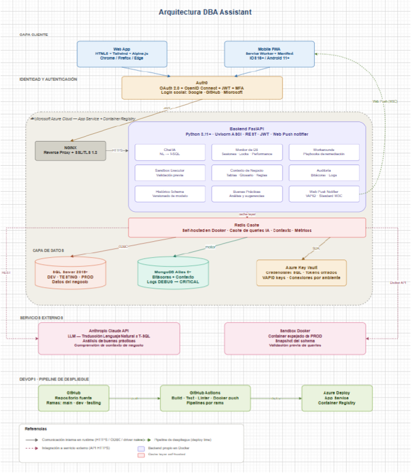

# Arquitectura

**Regla principal:** toda decisión técnica se mantiene lo más fiel posible a este
diagrama. Cualquier desvío se documenta acá con su motivo.

## Correspondencia diagrama → código

| Bloque del diagrama | Implementación |
|---|---|
| Web App (HTML5 + Tailwind + Alpine.js) | `backend/app/web/` — plantillas Jinja2 renderizadas por FastAPI, Alpine.js para la interactividad, Tailwind compilado (`backend/tailwind/`) |
| Mobile PWA (Service Worker + Manifest) | Mismo front adaptado: `static/manifest.webmanifest`, `static/sw.js` |
| Auth0 | Pendiente de configuración (ver `docs/auth0.md`) |
| NGINX (Reverse Proxy + SSL/TLS 1.3) | `nginx/` — TLS 1.3, estáticos y proxy al backend por HTTPS |
| Backend FastAPI (Python + Uvicorn ASGI) | `backend/app/` — un único servicio organizado en módulos; Uvicorn sirve HTTPS (`backend/arranque.sh`) |
| Módulos del backend | `backend/app/modulos/<modulo>/` (ver tabla siguiente) |
| Redis Cache (self-hosted en Docker) | `backend/app/datos/cache.py`, servicio `redis` |
| SQL Server 2019+ (ODBC) | `backend/app/datos/sqlserver.py` (pyodbc + ODBC Driver 18), servicio `sqlserver` |
| MongoDB 6+ (motor) | `backend/app/datos/mongo.py`, servicio `mongo` |
| Azure Key Vault | `backend/app/core/secretos.py` — hoy lee `.env`; al migrar se agrega el proveedor de Key Vault |
| Anthropic Claude API | Módulo `chat_ia` (modelo configurable, por defecto Claude Haiku 5.5) |
| Sandbox Docker | Servicio `sandbox` (`backend/app/sandbox_servicio`, imagen `Dockerfile.sandbox`) que administra los contenedores; el backend lo usa desde el módulo `sandbox` |
| GitHub Actions | `.github/workflows/ci.yml` |
| Azure Deploy | Diferido hasta que el sistema esté funcional |

### Módulos del backend

| Diagrama | Paquete |
|---|---|
| Chat IA (NL → T-SQL) | `chat_ia` |
| Monitor de BD (sesiones, locks, performance) | `monitor` |
| Workarounds (playbooks de remediación) | `workarounds` |
| Sandbox Executor (validación previa) | `sandbox` |
| Contexto de Negocio (tablas, glosario, reglas) | `contexto_negocio` |
| Auditoría (bitácoras, logs) | `auditoria` |
| Histórico Schema (versionado del modelo) | `historico_schema` |
| Buenas Prácticas (análisis y sugerencias) | `buenas_practicas` |
| Web Push Notifier (VAPID, estándar W3C) | `web_push` |
| Alertas *(agregado)* | `alertas` |
| Conexiones *(agregado: instancias registradas)* | `conexiones` |
| Inicio *(agregado: panel principal)* | `inicio` |
| Soporte *(agregado: panel técnico del Administrador)* | `soporte` |

## Decisiones tomadas

| Tema | Decisión |
|---|---|
| Front | Lo sirve el backend (Jinja2). NGINX entrega los estáticos. |
| Tailwind | Compilado con el ejecutable oficial (sin Node). El CDN no es apto para producción. |
| Backend | Un único servicio (monolito modular). |
| Python | 3.14, la última versión estable. |
| Dependencias | `uv` con `pyproject.toml` y `uv.lock`. |
| Linter / tests | `ruff` (lint y formato) y `pytest` con cobertura mínima del 80%. |
| SQL Server | Estructura funcional: tenants, conexiones, usuarios, roles, permisos por ambiente, métricas y umbrales, reglas de alerta, alertas, workarounds y versiones. Imagen 2022 en Docker, accesible desde SSMS en `localhost,14330`. |
| MongoDB | Bitácoras (transacciones, auditoría, excepciones, sandbox), contexto de negocio (con los PDF de los documentos de negocio y su conversión a Markdown en GridFS, bucket `documentos`), informes de buenas prácticas, snapshots de schema (de las instancias y de la base de la aplicación) y dispositivos push. |
| Redis | Contenedor propio. TTL configurables solo por variable de entorno. |
| Secretos | `.env` en local, detrás de una interfaz; Key Vault por ambiente al migrar a Azure. |
| IA | Claude Haiku 5.5 por defecto. |
| MFA | Obligatorio al ingresar; segundo factor nuevamente al ejecutar acciones sobre conexiones PROD. |
| Login | Google y email + contraseña, siempre con MFA. |
| Roles | Tres: Administrador, DBA y Consulta (no los cinco del diseño). Módulos por rol en la tabla siguiente. El Administrador tiene además todas las facultades operativas del DBA (`ROLES_OPERATIVOS`). |
| Instancias monitoreadas | Solo SQL Server sobre Windows. Las registra el usuario. |
| Sandbox (detalle) | Un contenedor persistente por cada IP registrada, con todas sus bases. Solo estructura. Se sincroniza a diario y se verifica alineación antes de cada validación. |
| Ejecución | Dry-run en sandbox y confirmación del usuario antes de ejecutar en la base real. |
| Alertas | Motor caído, base caída, bloqueos y poco espacio (disco, datos y log). Réplica, más adelante. Notificación por la PWA; email más adelante. |
| Ambientes | Uno solo por ahora. Ramas `main` y `dev`. |
| Mi perfil | Página `/perfil` (clic en el usuario de la barra superior), para todos los roles: nombre, idioma, cambio de contraseña (Auth0 envía el correo; no se muestra a quien entra con Google) y dispositivos con push, que se pueden quitar. Rol y ambientes en solo lectura. |
| Idioma | Español e inglés (`app/web/i18n/es.json` y `en.json`, mismas claves; sumar un idioma es agregar su archivo y su código en `IDIOMAS`). Lo elige cada usuario en la barra superior y se guarda en su perfil (`usuario.idioma`); si nunca eligió, se toma el del navegador (Accept-Language) y se guarda en su primer ingreso. Se traduce toda la aplicación: pantallas, mensajes de error (`error.<código>`), workarounds integrados, alertas (se guardan como clave y parámetros y cada uno las ve en su idioma), avisos push y correo (en el idioma de cada destinatario), respuestas de la IA, hallazgos de Buenas Prácticas, exportes de Auditoría, pantalla de Auth0 (`ui_locales`) y manifest de la PWA. Fechas y números con el formato del idioma (Intl). Quedan en el idioma en que se generaron los registros históricos (bitácoras, informes de Buenas Prácticas, hilos del chat) y los logs internos. |
| Multi-tenant | Desde el inicio. Base central `<prefijo>_Catalogo` con la lista de tenants; por cada tenant una base SQL Server `<prefijo>_T_<slug>` y una base MongoDB `<prefijo>_t_<slug>`. Las tablas llevan además `tenant_id` como segunda barrera. Alta automática con `python -m app.cli crear-tenant`. |
| Identidad por tenant | Auth0 Organizations: una organización por cliente; cada cliente entra por su subdominio (`<cliente>.localhost` en desarrollo). |
| Sesión | Login en el backend con Auth0; JWT guardado en Redis y cookie segura (HttpOnly) en el navegador. Duración fija de 8 horas, sin cierre por inactividad. |
| Roles | Se guardan en la base del tenant; Auth0 solo verifica identidad, MFA y pertenencia a la organización. |
| Sandbox | Un contenedor por IP registrada y por tenant. |
| Cambios de estructura | Scripts T-SQL numerados en `backend/app/datos/migraciones/{catalogo,tenant}`, aplicados automáticamente al arrancar. |
| Monitoreo | Recolector en segundo plano dentro del backend: lee todas las conexiones cada 3 s (`MONITOR_INTERVALO_SEGUNDOS`) con una conexión persistente por instancia, aunque nadie tenga el dashboard abierto. Un candado en Redis asegura un solo recolector si hay varias réplicas. Última lectura en Redis; el dashboard refresca cada 3 s. Si la instancia no responde se muestran los últimos valores marcados como obsoletos (CON_DB_003). |
| Métricas | CPU del proceso de SQL Server; memoria física del servidor; espacio del volumen más lleno con archivos de bases; latencia = duración promedio de las consultas en curso; sesiones de usuario activas; sesiones bloqueadas; deadlocks de 24 h (`system_health`, leído cada minuto); conexiones por segundo. El login necesita `VIEW SERVER STATE`. |
| Umbrales de monitoreo | Warning y critical por conexión y métrica (critical > warning), con los valores del diseño por defecto; en la base SQL del tenant. Los configuran Administrador y DBA; Consulta ve el monitoreo de todas las conexiones en solo lectura. |
| Retención | Bitácoras y excepciones: 5 años (requisito del TFI). |
| Capas | Cada módulo con `api`, `servicios`, `repositorios` y `entidades` (más archivos de apoyo cuando hace falta: motor IA, chequeos, lectura de DMVs, ejecución). Las consultas a la base de la app y a las instancias registradas van en `repositorios` o en esos archivos de apoyo, no en `servicios`. Catálogo central de códigos de error del TFI. |
| Biometría móvil | Passkeys (WebAuthn, librería `webauthn`) registradas por cada usuario en *Mi perfil*, con el segundo factor de Auth0 vigente. Reemplazan solo la reconfirmación con segundo factor (PROD, DELETE, tablas sensibles, autorización propia, automatizaciones): el dispositivo la resuelve con huella, rostro o PIN sin salir de la app; si no tiene passkey, se confirma con el código del autenticador en Auth0. Exigen verificación del usuario, desafío de un solo uso (Redis, 5 min) y quedan atadas al subdominio del tenant. El ingreso sigue siendo Auth0 + MFA. |
| Perímetro de consulta | Tablas autorizadas por rol (a detallar). |
| Restaurar schema | En espera. |
| Baja de usuarios | Desaparece del Panel Admin y queda deshabilitado 30 días (se puede rehabilitar); luego se elimina y hay que darlo de alta de nuevo. La bitácora conserva su historial. |
| Cambio de rol | No cierra la sesión: el rol se relee en cada petición y se ve al recargar. |
| Conexiones | Una conexión es una instancia SQL Server (las bases se eligen al usarla). Autenticación SQL (usuario y contraseña). Datos opcionales de WinRM para el servicio de Windows. Las gestionan Administrador y DBA desde el menú **Conexiones**. |
| Credenciales de conexiones | Cifradas (Fernet) en la base del tenant con la clave maestra `SECRETO_CLAVE_CIFRADO`; al migrar a Azure pasan a Key Vault. La API nunca devuelve contraseñas. |
| Certificado de las instancias | Siempre se confía en el certificado del servidor (las instancias de clientes suelen usar certificados autofirmados). La conexión igual viaja cifrada. |
| Acciones sobre PROD | Exigen confirmar con el segundo factor en el momento: con la sesión de Auth0 vigente, Auth0 pide solo el código del autenticador (sin credenciales); la app lo acepta si el token trae el claim de la Action "Exigir MFA siempre", se emitió hace menos de 2 minutos y corresponde a ese pedido (nonce). La confirmación vale 5 minutos. El MFA del ingreso no cuenta. |
| Permisos por ambiente | Por ahora, ambientes habilitados por usuario; las acciones finas se suman con cada módulo. |
| Notificaciones push | Web Push con VAPID (W3C), sin servicios de terceros. Claves con `python -m app.cli generar-vapid`; la privada es un secreto. Requieren HTTPS con certificado confiable. |
| Alertas (motor) | Se evalúan sobre cada lectura del recolector. Orígenes: umbrales de Monitoreo (warning/critical, sostenidos 1 min), eventos fijos (instancia sin conexión y base no disponible: critical, confirmados en 5 s; bloqueo > 30 s y log > 90%: warning; backups fuera de la política, jobs que fallan o se demoran y SQL Server Agent detenido: ver Backups y Jobs) y reglas propias (métrica, condición, severidad, tiempo sostenido, todas las conexiones o una, roles destinatarios y push). Una sola alerta activa por condición e instancia: se actualiza y escala, no se duplica. Al normalizarse sigue activa hasta que la atiendan (acción manual o falsa alarma, con comentario). Notificación: reglas según su configuración (push, email o ambos); umbrales y eventos, solo critical, a Administradores y DBA, por push y email. Escalamiento: fuera de alcance por ahora. |
| Notificación por correo | SMTP genérico (`app/datos/correo.py`): Gmail u Outlook con contraseña de aplicación en desarrollo; el SMTP de Azure Communication Services al desplegar. Cada regla elige push, email o ambos; umbrales y eventos críticos salen por los dos canales. |
| Atención de alertas | Atienden y desestiman Administrador y DBA (decisión revisada); Consulta solo ve. |
| Workarounds | Biblioteca con 13 integrados (liberar sesiones bloqueantes eligiendo cuáles, shrink del log, rebuild de índices, update statistics, limpiar plan cache por base, checkpoint, iniciar el servicio por WinRM, poner online una base OFFLINE, programar un backup full o de log, reintentar un job, iniciar el SQL Server Agent y activar Query Store; las bases en SUSPECT, RECOVERY_PENDING o EMERGENCY se muestran pero no se tocan, porque necesitan diagnóstico manual) y propios con pasos T-SQL, versiones y validación de sintaxis (NOEXEC). Crean y modifican Administrador y DBA; ejecutan los roles que define cada workaround. Fuera de la ventana de mantenimiento, los integrados pesados piden una autorización de un Administrador o DBA (quien la pidió puede darla, con segundo factor; queda marcada como propia en la bitácora). Ejecución paso a paso con progreso en vivo, en una transacción cuando el workaround lo admite (si falla, se revierte todo; si no, se detiene e informa). PROD exige segundo factor y que el usuario tenga el ambiente habilitado. Todo queda en la bitácora de transacciones (con flag mobile). |
| Ventana de mantenimiento | Por conexión, con zona horaria (Buenos Aires por defecto). Rebuild de índices y update statistics fuera de la ventana requieren la autorización de un Administrador o DBA (puede ser el propio solicitante, con segundo factor); el pedido vence a las 24 h y, autorizado, el solicitante tiene 2 h para ejecutarlo. |
| Ejecución automática | Solo integrados aptos ante eventos: log > 90% → shrink del log o checkpoint; instancia sin conexión → iniciar servicio; base no disponible → poner online la base (si está OFFLINE; una base offline a propósito se excluye desestimando su alerta). La configuran Administrador y DBA; para PROD o todas las conexiones exige segundo factor. Cada ejecución se audita y se avisa a Administradores y DBA. |
| HTTPS interno (NGINX → Uvicorn) | Como indica el diagrama, el tramo interno también va por HTTPS con TLS 1.3. Uvicorn sirve con el certificado de `/srv/tls`; si no se montó uno, el backend genera al arrancar uno autofirmado (EC P-256, nombre `backend`, renovado 30 días antes de vencer: `python -m app.cli certificado-interno`). NGINX lo recibe por un volumen de solo lectura y lo usa como única autoridad de confianza para verificar al backend (`proxy_ssl_verify`). |
| Celular | En pantallas chicas, barra inferior con Inicio, Alertas (con contador), Chat IA, Workarounds y "Más" (abre el menú). En el detalle de una alerta, la remediación sugerida va primero, con un botón grande; al tocar una alerta el detalle se lleva a la vista. Confirmación biométrica con passkeys. Para usarla desde el celular con push y biometría, túnel de Cloudflare (`docs/tunel.md`). |
| Sandbox | Servicio aparte, único con acceso al socket de Docker y sin puertos publicados; el backend lo usa por la red interna con un token compartido. Un contenedor SQL Server 2022 Developer por servidor de origen y tenant, con 2 GB de RAM y volumen propio. |
| Estructura del Sandbox | sqlpackage (paquete oficial de Microsoft desde NuGet, sobre .NET 8): extrae el esquema sin datos ni usuarios y recrea cada base en el Sandbox. Sincronización diaria a la hora local de cada conexión (03:00 por defecto) y a pedido. Antes de cada validación se compara una huella de la estructura con el origen; si no coincide o tiene más de 24 h, se avisa (SBX_SNP_000). |
| Ejecución en Sandbox | Compilación previa (NOEXEC), luego ejecución con SET STATISTICS XML (tiempo, filas, plan real) dentro de una transacción que siempre se revierte; timeout de 60 s. Cada ejecución queda en la bitácora de Sandbox (MongoDB). |
| Promover a PROD | Administrador y DBA. Muestra filas y plan estimados en la base real (SHOWPLAN) frente al Sandbox; exige segundo factor si la conexión es PROD; ejecuta en una transacción y revierte ante una falla. Se registra en la bitácora de transacciones con flag de promoción y se avisa a Administradores y DBA. |
| Desestimar alertas | Administrador o DBA marcan una condición de una instancia como esperada (por ejemplo, una base offline a propósito), con motivo y vencimiento opcional (24 h, 7 d, 30 d, una fecha o sin vencimiento). La alerta se cierra como "desestimada" y la condición no vuelve a alertar mientras esté vigente; se lista en Alertas → Desestimadas y se puede reactivar. Todo auditado. |
| Inicio (panel principal) | Resumen con datos que la app ya guarda, sin consultar las instancias, filtrable por ambiente (Todos, DEV, TESTING, PROD; se recuerda en el navegador) y refrescado cada 30 s: instancias monitoreadas (nuevas del mes), alertas activas (críticas), workarounds disponibles (nuevos del mes; solo Administrador y DBA), consultas validadas en Sandbox pendientes de promoción en los últimos 7 días (solo las que modifican datos), acciones rápidas según el rol y salud general. La disponibilidad del mes (calendario de Buenos Aires) sale de las alertas "instancia sin conexión": 1 − tiempo caído ÷ tiempo desde el inicio del mes o el alta de la instancia, promediado entre instancias. Latencia p95 de la última hora (histórico de métricas), sesiones activas e instancias online de la última lectura, y bloqueos de más de 30 s. "Consultas hoy" y "Actividad reciente" del diseño no se muestran: esa información queda en las bitácoras (Auditoría). |
| Contexto de negocio | Por conexión y base, en MongoDB (`contexto_negocio`): tablas sensibles (roles que consultan, columnas enmascaradas y roles que las ven, doble confirmación para modificar), glosario (término, sinónimos, entidad validada contra el esquema y definición) y reglas (acciones, ámbito por instancia, base, ambiente y tablas, franja horaria local, prioridad, bloquear o advertir). Lo editan Administrador y DBA; Consulta lo ve. Cada cambio queda en la bitácora de auditoría con el valor anterior y el nuevo. |
| Backups | El recolector lee de `msdb` cada 5 minutos el último backup full, diferencial y de log de cada base (los de los últimos 40 días, de la misma base por su GUID). Política por conexión (tabla `politica_backup` en SQL Server; por defecto, full cada 24 h y log cada 60 min en recuperación FULL o BULK_LOGGED), configurable por Administrador y DBA y auditada. Alertas con push y correo: sin full dentro del plazo (warning; critical al doble o si nunca se respaldó), sin log dentro del plazo (warning); se cierran solas al aparecer el backup. WK-09 y WK-10 no respaldan en el momento: crean un job del SQL Server Agent de una sola ejecución (por defecto, al inicio de la próxima ventana de mantenimiento, en hora del servidor) que se borra al terminar bien; el full es COPY_ONLY (no altera la cadena de la empresa) y el de log es normal (libera el log). En Express, sin Agent, no se ofrecen. |
| Jobs del SQL Server Agent | El recolector lee cada minuto el estado del servicio Agent y de cada job (último resultado, error del paso que falló, si está corriendo, duración promedio y próxima ejecución). Alertas con push: job que falló en los últimos 7 días (se cierra con la siguiente ejecución exitosa), job demorado (más de 3 veces su promedio y al menos 5 min) y Agent detenido con inicio automático (critical). Sin permiso sobre `msdb`, esas alertas no se dan por normalizadas. Historial de ejecuciones con sus pasos y explicación de la falla con la IA (Administrador y DBA; se guarda un día por ejecución para no repetir el pedido). WK-11 reintenta un job y WK-12 inicia el Agent por WinRM. |
| Consultas costosas (Query Store) | Ranking por base desde el Query Store de cada una (SQL Server 2016+), leído bajo demanda con caché de 5 minutos en Redis: la historia queda en la base, con su propia retención. Métrica (CPU, duración, lecturas o ejecuciones) y período (1 h a 30 días), mini-gráfica por consulta y marcas sin push: "empeoró" (últimas 24 h vs. los 7 días previos, por ejecución, más de un 50% y con al menos 10 ejecuciones en cada período) y "cambió el plan". Detalle con el texto, los planes y su serie, "Analizar con IA" (Buenas Prácticas, que también recibe estas regresiones) y "Probar en Sandbox". WK-13 activa Query Store en una base. Las lecturas propias llevan una marca y se excluyen del ranking. |
| Documentos de negocio | Cuarta categoría de Contexto de Negocio. Cualquier rol carga un PDF (hasta 10 MB, con texto; un escaneo sin OCR se rechaza) con solo elegir el archivo: queda asociado a la conexión y la base seleccionadas, sin indicar si es funcional o no funcional. El PDF se convierte a Markdown con MarkItDown (conserva títulos, listas y tablas y gasta menos tokens) y ambos van en GridFS (MongoDB). La IA lo interpreta una vez, en segundo plano: arma un resumen orientado a los datos, lista las tablas relacionadas y propone términos para el glosario y reglas operativas, validados contra el esquema y sin repetir lo ya cargado. Las propuestas se aceptan (Administrador y DBA, con las validaciones del alta manual) o se descartan de a una. Quien cargó el documento, el Administrador y el DBA corrigen el resumen, lo vuelven a interpretar (sin volver a ofrecer lo ya aceptado o descartado) y eliminan; el resto ve y descarga. La IA (Chat IA y Buenas Prácticas) recibe solo los resúmenes listos, no el documento entero. Carga, corrección (valor anterior y nuevo), reinterpretación, propuestas aceptadas o descartadas y baja quedan en la bitácora de auditoría. |
| Esquema de las instancias | Se lee de las DMVs de catálogo (tablas, vistas, columnas, PK y FK de cada base accesible) y se guarda en Redis (`CACHE_TTL_CONTEXTO`); se puede actualizar a mano desde Contexto de Negocio. |
| Chat IA (motor) | Claude por el SDK oficial de Anthropic, con salida estructurada (T-SQL, base, explicación y confianza). Instrucciones y esquema + contexto van en el prompt de sistema con caché de prompts; las traducciones se guardan en Redis (`CACHE_TTL_IA`) con una clave que incluye el contexto. El usuario elige la instancia y la IA elige la base. Los hilos se guardan por usuario en MongoDB (sin los datos de los resultados) y la IA recibe los últimos turnos para las preguntas de seguimiento. |
| Chat IA (alcance) | Solo atiende pedidos sobre las bases de las instancias registradas. La IA clasifica cada pedido como datos (datos y estructura de las bases), motor (estado de la instancia: sesiones, bloqueos, errores recientes, estado y espacio de las bases, jobs) o ajeno. Lo ajeno no se responde: mensaje fijo traducido (se descarta el texto de la IA), no entra al historial que recibe la IA y queda en la bitácora de auditoría (`chat.pedido_no_atendido`). Las consultas al motor son solo de Administrador y DBA; además de la clasificación, se detectan sobre el propio T-SQL (DMVs, funciones y vistas de servidor, bases de sistema), también al editar o ejecutar a mano. |
| Chat IA (ejecución) | El T-SQL se analiza antes de ejecutar (sqlglot). SELECT: se ejecuta solo al traducirlo (aunque la confianza sea baja), sin segundo factor; el resultado es lo principal de la respuesta, con hasta 1.000 filas y el total ("1.000 de N"), y el CSV exporta todas; la consulta queda plegada en un apartado "Query". Una lectura alcanzada por una regla que advierte espera la confirmación. INSERT, UPDATE y DELETE: con la confirmación del usuario, que antes ve en palabras qué se modifica (tabla, valores, condición y, en UPDATE y DELETE simples, cuántas filas la cumplen en ese momento), armado desde el propio T-SQL; WHERE obligatorio (en INSERT…SELECT, en su SELECT), sin bloqueos ni transacciones abiertas de otras sesiones sobre las tablas, en una transacción con LOCK_TIMEOUT de 5 s; piden segundo factor en PROD, en DELETE y en tablas sensibles con doble confirmación. DDL, MERGE, EXEC o varias sentencias: obligatoriamente por el Sandbox y Promover. Consulta solo ejecuta SELECT. Solo en conexiones de ambientes habilitados al usuario. Todo queda en la bitácora de transacciones. |
| Enmascaramiento | El origen de cada columna del resultado lo informa el motor (`sp_describe_first_result_set`), así que cubre alias y JOINs; una columna calculada que menciona una columna sensible también se oculta. Si no se puede verificar el origen, no se muestran los datos. |
| Promover a PROD (ampliación) | Además de PROD, toda sentencia con DELETE, TRUNCATE o DROP pide segundo factor; las reglas de negocio de bloqueo impiden promover y las de advertencia se muestran en la comparación previa. |
| Buenas prácticas | Análisis por conexión y base a pedido (Administrador y DBA; Consulta no ve el módulo). Chequeos objetivos sobre el motor: consultas más costosas en CPU (la base sale del atributo `dbid` del plan), índices faltantes del optimizador, fragmentación (`dm_db_index_physical_stats` en modo LIMITED, índices de más de 1.000 páginas, REORGANIZE entre 5% y 30%, REBUILD desde 30%) y esquema (tablas sin PK, heaps, FK sin índice, tipos obsoletos). El motor IA recibe los hallazgos, el esquema, el contexto de negocio y las reglas propias del equipo, y devuelve sugerencias por tipo y severidad con su T-SQL. El análisis corre en segundo plano y el informe queda en MongoDB. Aplicar una sugerencia y definir las reglas (Administrador y DBA) pasa por el Sandbox y se promueve desde ahí. El botón "Optimizar" de Monitoreo abre un análisis de consultas lentas de la instancia. |
| Auditoría | Tres bitácoras en MongoDB (5 años): transacciones (Administrador y DBA), auditoría del sistema (solo Administrador, CU-000-009-B) y excepciones (solo Administrador). El menú Auditoría muestra las transacciones (lo ejecutado desde la app sobre las instancias); las otras dos son técnicas y están en Soporte. Listado paginado con filtros por fecha (días de Buenos Aires), usuario, ambiente, tipo de acción o nivel y texto; detalle con el registro completo. Cada evento guarda la IP de la petición. |
| Exportación de auditoría | CSV (hasta 1.000.000 de registros) y PDF (hasta 10.000) sin firma digital (firma omitida por ahora); por encima, EXP_LIM_000. Cada exportación queda en la bitácora de auditoría. |
| Bitácora de excepciones | Los logs de la app desde el nivel que elige el Administrador (WARNING por defecto) se guardan en la base del tenant con módulo, código de error, usuario, ruta y traza. Incluye las respuestas HTTP con error (4xx como WARNING y 5xx como ERROR, con método, estado, duración y la traza de las excepciones no controladas); el campo `origen` (HTTP o código) permite filtrarlas. Un hilo aparte escribe en MongoDB desde una cola, así el log nunca espera a la base. Los logs sin tenant van a la base de la plataforma. |
| Histórico de métricas | Colecciones *time-series* de MongoDB, retención de 30 días (`MONITOR_RETENCION_DIAS`). Rangos de 1 h, 24 h, 7 d y 30 d, promediados por tramo. |
| Histórico de schema | Registra lo ejecutado desde la app (Promover desde el Sandbox y workarounds propios con DDL): usuario que escribió la sentencia, quién la autorizó, DDL y diff. Antes y después de cada ejecución se toma un snapshot de la base desde el catálogo (tablas con columnas, PK, FK e índices; código de vistas, procedimientos, funciones y triggers) y la versión guarda el resultado y las diferencias (MongoDB, `schema_versiones`). Un DDL que no cambia la estructura no genera versión; si no se pudo leer la estructura, queda el DDL sin diff. Se comparan dos versiones o una con el estado actual (que sí muestra lo hecho fuera de la app) y la comparación se descarga como texto. Lo ejecutado fuera de la app (SSMS, etc.) no genera versiones. |
| Soporte *(agregado)* | Panel técnico solo para el Administrador, con tres pestañas. **Servicios y colas:** salud de SQL Server, MongoDB, Redis, Auth0 y Sandbox (movida desde el Panel Admin), la cola de la bitácora de logs (pendientes, escritos, descartados y fallidos) y los procesos en segundo plano (recolector y programador del Sandbox: activo, en espera de otra réplica o detenido); los datos son de la réplica que atiende. **Registros:** bitácoras de excepciones (logs) y del sistema, con el mismo filtro, detalle y exportación que Auditoría y el nivel de log. **Base interna de la aplicación:** ver la fila siguiente. |
| Historia de la base de la aplicación | Requisito del TFI de recuperar datos y estructura a través del tiempo, para la base SQL Server de cada tenant. **Datos:** tablas temporales con versión del sistema (migración 014) en `usuario`, `usuario_ambiente`, `conexion`, `umbral_metrica`, `regla_alerta`, `politica_backup`, `workaround`, `automatizacion_workaround` y `alerta_desestimada`; historia en el esquema `historia`, retención de 5 años, columnas del período ocultas. Se consulta (solo lectura) la tabla en un momento o todas las versiones de las filas; las contraseñas no se muestran. **Estructura:** un trigger DDL de base registra cada cambio en `dbo.historial_ddl` (evento, objeto, login, programa, equipo y T-SQL), también los hechos fuera de la app; además, al arrancar el backend y a pedido se toma un snapshot del catálogo (el mismo del Histórico de Schema) y, si cambió, se guarda una versión en MongoDB (`schema_aplicacion`) con su origen: inicial, migraciones nuevas (según `dbo.migracion_aplicada`), cambio detectado por fuera o captura manual. Cada versión se compara con otra o con el estado actual y se descarga como script para recrear la estructura. La restauración desde la app queda fuera de alcance. Las conexiones de la app se identifican como `DBA Assistant` (APP de ODBC). |
| Diseño visual (rediseño 2026) | Sistema "años 50 corporativo" de `design/rediseno-2026/`: tokens en `backend/tailwind/diseno.css` (los nombres anteriores quedan como alias), Jost para títulos y cifras, Libre Franklin para la interfaz e IBM Plex Mono solo para valores técnicos (T-SQL, códigos, identificadores). Números y fechas con el formato del idioma (`window.DBA.numero`, `fecha`, `hora`, 24 h) y plurales con las dos formas en los textos. Los errores de carga se muestran con un aviso común (`parciales/aviso_error.html`): mensaje humano, *Reintentar* y el código técnico plegado. |
| Estado general (Inicio) | Lo calcula el backend a partir de las alertas abiertas del ambiente filtrado: *Requiere atención* si hay alguna crítica (nombra los ambientes afectados, de PROD a DEV), *Con observaciones* si solo hay advertencias y *Operativo* si no hay ninguna. |
| Riesgo de las remediaciones | Cada remediación tiene un riesgo (bajo, medio o alto), distinto de la severidad de la alerta que la sugiere. Las integradas lo tienen fijo según lo invasivo de la acción (alto: terminar sesiones, iniciar servicios, poner una base en línea, iniciar el Agent); las propias lo toman de su criticidad (info → bajo, warning → medio, critical → alto). En PROD, ejecutar pide escribir el nombre de la instancia (alias de la conexión) y luego el segundo factor. |
| Última prueba de conexión | La prueba de una conexión ya registrada guarda fecha y resultado (migración 015, columnas `ultima_prueba_en` y `ultima_prueba_ok` en `dbo.conexion`); la de una conexión que se está creando no se guarda. El listado avisa si la conexión usa el login `sa` o si el mismo servidor está registrado en otro ambiente. |
| Plataforma y Operador *(agregado)* | Rol **Operador** a nivel plataforma, fuera de las empresas: administra la plataforma (empresas, invitaciones, operadores) desde `plataforma.<DOMINIO_BASE>` y **no accede a los datos de ninguna empresa**; solo entra a una empresa en una sesión de soporte acotada (ver la fila "Acceso de soporte del Operador"). Ingresa por Auth0 con segundo factor contra una organización interna `plataforma` (la crea `crear-operador`; tabla `dbo.plataforma` del catálogo); el primer operador se crea por comando y los demás desde la consola. Operadores en `dbo.operador` del catálogo; se releen en cada petición (una baja corta el acceso al instante y lo quita de la organización de Auth0). Nadie puede darse de baja a sí mismo. Acciones auditadas en la base MongoDB de plataforma (`plataforma.*`). |
| Alta de empresas por invitación | El operador invita por email (enviar por correo o copiar el link); la invitación (`dbo.invitacion_empresa`, migración 002 del catálogo) vence **24 h** después y queda una sola abierta por email. El link es fijo (`registrar-empresa.<DOMINIO_BASE>/registra-tu-empresa`): la seguridad no depende de que sea secreto sino del email. La persona prueba que controla el email con un **código de 6 dígitos por correo** (solo se guarda su hash; vence a los 10 min; 5 intentos; un pedido por minuto y 5 por hora por email; 30 verificaciones por hora por IP; las respuestas no revelan si un email tiene invitación). Con eso abre una sesión de registro de 30 min (cookie HttpOnly, SameSite=Strict), elige nombre, dirección (`<slug>.<DOMINIO_BASE>`, con disponibilidad en vivo; no se puede cambiar después) y su nombre, y **Configurar** corre el alta de siempre en segundo plano con el avance por pasos. Un bloqueo en Redis impide dos altas simultáneas de la misma invitación (también entre réplicas); si el alta falla o se interrumpe, se reintenta con la misma dirección. Al terminar, la invitación queda usada y la persona entra a su empresa por Auth0 como primer Administrador. Requiere SMTP. |
| Subdominios reservados | `plataforma`, `registrar-empresa`, `www`, `api`, `app`, `admin`, `auth`, `login`, `mail`, `smtp`, `static`, `soporte`, `status` y `docs` no pueden ser la dirección de una empresa (TEN_VAL_004). |
| Acceso de soporte del Operador | Desde la consola, el operador toca la dirección de una empresa activa: se le pide el segundo factor (Auth0, como las acciones sobre PROD) y recibe un pase de un solo uso que vence a los 60 s, atado a él y a esa empresa. El subdominio de la empresa lo canjea por una **sesión de soporte de 1 hora**, de solo lectura, que solo ve Soporte con dos pestañas: **Servicios y colas** y **Errores de la aplicación**. Los errores son solo los de nivel ERROR o CRITICAL (excepciones del código y respuestas 5xx) y se muestran saneados: ruta como plantilla (`/api/x/{id}`, la guarda el registro HTTP), código de error con su mensaje del catálogo, tipo de excepción sin su mensaje y marcos de la traza dentro de `app/`; nunca usuario, IP, mensaje del log ni valores. Sin acceso a bitácoras, auditoría, historia de la base ni a ningún otro módulo (el servidor lo exige con el módulo `soporte_operador`). El operador no es usuario de la empresa: se valida contra la plataforma en cada petición (una baja corta el acceso). Cada acceso queda en la auditoría de la empresa (`soporte.acceso_operador`, `soporte.salida_operador`) y de la plataforma, y se avisa por correo a los Administradores de la empresa. El aviso fijo de la sesión tiene el botón **Volver a la plataforma**, que cierra la sesión de soporte y vuelve a la consola sin salir de Auth0. |
| Suspensión de empresas | El operador suspende o reactiva una empresa (`dbo.tenant.estado`). Suspendida: sus usuarios no pueden ingresar, las sesiones abiertas dejan de valer y el monitoreo y el programador del Sandbox la saltean; no se borra ningún dato. Otras réplicas lo aplican al vencer su caché de empresas (60 s). |

## Módulos por rol

| Módulo | Administrador | DBA | Consulta |
|---|---|---|---|
| Inicio, Alertas, Monitoreo | ✔ | ✔ | Solo lectura |
| Chat IA | ✔ | ✔ | Solo consultas SELECT |
| Contexto de Negocio, Historial de esquema | ✔ | ✔ | Solo lectura |
| Remediaciones (workarounds), Sandbox | ✔ | ✔ | ✘ |
| Auditoría (bitácora de transacciones) | ✔ | ✔ | ✘ |
| Panel Admin (usuarios) | ✔ | ✘ | ✘ |
| Soporte (servicios y colas, registros, auditoría del sistema, base interna de la aplicación) | ✔ | ✘ | ✘ |

El **Operador** es un rol de la plataforma, no de una empresa: ve su consola (`plataforma.<DOMINIO_BASE>`) y, en una sesión de soporte, solo la vista acotada de Soporte de una empresa (servicios y colas, errores de la aplicación sin datos); ninguno de los módulos de arriba.

## Desvíos respecto del diagrama

| Diagrama | Implementación | Motivo |
|---|---|---|
| Driver `motor` para MongoDB | API asíncrona de PyMongo (`AsyncMongoClient`) | MongoDB deprecó Motor en 2026; la API asíncrona de PyMongo es su reemplazo oficial y mantiene el mismo modelo de uso. Aprobado. |
| Contexto de Negocio con cinco categorías (tablas sensibles, glosario, reglas, joins predefinidos y métricas custom) | Las tres categorías del TFI (CU-000-006 A, B y C) más documentos de negocio *(agregado)* | Los joins se obtienen de las claves foráneas del esquema y se envían a la IA; joins y métricas propias quedan para más adelante si hacen falta. Aprobado. |
| Panel principal con "Consultas hoy" y "Actividad reciente" | Sin esos dos apartados | La actividad queda solo en las bitácoras (módulo Auditoría). Decisión del usuario. |
| Sin pantalla de Buenas Prácticas en el diseño (solo el botón "Optimizar" del Monitoreo) | Ítem "Buenas Prácticas" en la sección Conocimiento, con el estilo del resto de las pantallas, y el botón "Optimizar" habilitado | El TFI define el módulo (CU-000-007) pero el diseño no lo dibuja. Aprobado. |
| Pantalla de ingreso del diseño con campos de email, contraseña y código MFA | La pantalla de la app solo tiene el botón **Ingresar**; credenciales y MFA se cargan en la pantalla de Auth0 (Universal Login) | Las credenciales nunca pasan por la app: es la práctica recomendada por Auth0 y la que permite Google + MFA. La pantalla de Auth0 se puede personalizar con los colores del diseño. |
| TFI: promover, aplicar sugerencias y crear workarounds son del DBA | El Administrador también puede hacerlo (tiene todas las facultades operativas del DBA) | Un equipo sin DBA designado debe poder operar la aplicación completa. Decisión del usuario. |
| Conexiones dentro del Panel Admin | Menú propio **Conexiones** en Sistema | El DBA también gestiona conexiones y el Panel Admin es solo del Administrador. |
| Invitación de Auth0 al nuevo usuario (CU-001-000-A) | Aviso de acceso por correo propio (SMTP), en el idioma del usuario, con la dirección de su empresa; se reenvía desde el Panel Admin | Decisión del usuario. Auth0 suma a la organización a quien se autentica, pero la app solo deja entrar a quien está dado de alta en el tenant y, en el primer ingreso, con email verificado. |
| Login social con Google, GitHub y Microsoft | Google y email + contraseña | GitHub y Microsoft no se agregan por ahora. Decisión del usuario. Sumarlos es configuración de Auth0 (conexiones sociales) y de `CONEXIONES_TENANT`. |
| Ramas `main`, `dev` y `testing` | Solo `main` y `dev` | No se incluye `testing` por ahora (un solo ambiente). Decisión del usuario. |
| Sin panel técnico en el diagrama ni en el diseño | Menú **Soporte** en Sistema, solo para el Administrador, con el estilo del resto de las pantallas *(agregado)* | Reúne lo que no suele estar visible en una aplicación: salud de servicios, colas, logs, auditoría del sistema e historia de la base. Decisión del usuario. La bitácora de transacciones queda en Auditoría. |
| Sin túnel en el diagrama | Servicio `tunel` (Cloudflare) en Docker Compose, perfil opcional *(agregado)* | Solo para desarrollo: publica la app con HTTPS confiable para probar push y biometría en el celular (`docs/tunel.md`). No forma parte del despliegue. |
| MongoDB Atlas | MongoDB en Docker (provisorio) | Pendiente de decisión (ver `docs/pendientes.md`). |
| TFI CU-000-004-E: push vía Firebase Cloud Messaging | Web Push con VAPID (W3C) | Es lo que indica el diagrama ("Web Push Notifier, VAPID, estándar W3C"); no depende de terceros. |
| Sin servicio de correo en el diagrama | Correo saliente por SMTP *(agregado)* | El CU-000-004-A del TFI pide destinatarios por canal push/email. |
| TFI CU-000-004-E: dispositivos registrados en MongoDB | Suscripciones en la base SQL Server del tenant | Regla del proyecto: estructura funcional en SQL Server; se borran en cascada con el usuario. |
| Diseño original (`design/DBA Assistant.html`) | Rediseño 2026 (`design/rediseno-2026/`) | Revisión de diseño pedida por el usuario: legibilidad, estado antes que dato y separación entre severidad y riesgo. El diseño original queda como antecedente. |
| Nombres del diseño: Workarounds, Histórico de Schema, Logs, Historia de la base | Remediaciones, Historial de esquema, Registros, Base interna de la aplicación | Nombres en castellano llano. Las rutas, permisos y la API conservan `workarounds` y `schema`. |
| Selector de idioma en la barra superior | Usuarios de empresa: solo en **Mi perfil**. Operadores: selector ES \| EN en la barra de la consola y de la sesión de soporte (se guarda en `dbo.operador.idioma`, migración 003 del catálogo). Pantallas sin sesión (ingreso, registro de empresa): selector ES \| EN guardado en la cookie `dba_idioma` | El idioma es una preferencia de la cuenta (también define el de los avisos por correo y push); en la app de cada empresa se quita de la barra para no competir con las acciones. Los operadores no tienen "Mi perfil" y quien todavía no ingresó no tiene cuenta: para ellos el selector queda a la vista. Con sesión, la preferencia guardada manda sobre la cookie y el navegador. |
| Confirmación de riesgo alto con casillas de código MFA | Nombre de la instancia + segundo factor existente (llave de acceso o Auth0) | La app no emite códigos propios: el segundo factor ya implementado es el que valida el backend. |
| Alta de empresas por comando del administrador del sistema (`crear-tenant`) | Consola de la plataforma con rol Operador y registro por invitación con código por correo *(agregado)*; el comando queda como respaldo | Decisión del usuario: que la empresa cargue sus datos sin acceso al servidor. El código por correo prueba el email solo para el registro (no es un segundo factor); el ingreso a la empresa sigue por Auth0 con MFA. Se evitó una segunda aplicación de Auth0 para el registro. |
| Operador sin acceso a las empresas (decisión del Sprint 16) | Sesión de soporte acotada, de solo lectura y con segundo factor | Decisión del usuario: poder diagnosticar fallas de la aplicación en una empresa. Se limita a salud de servicios y errores saneados, sin datos ni logs del cliente, auditado y avisado a sus Administradores. |
